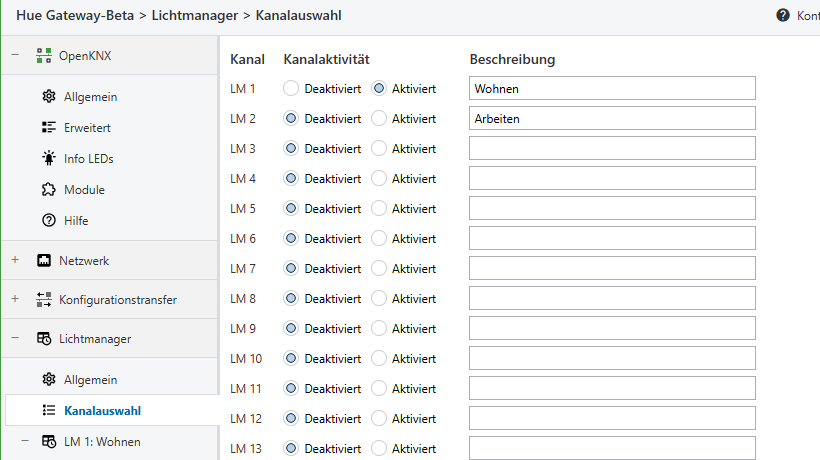
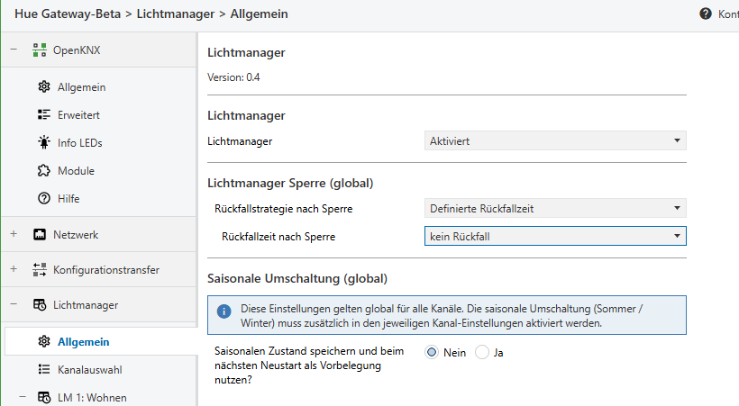
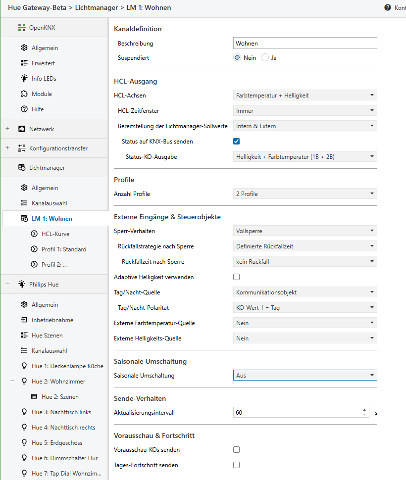
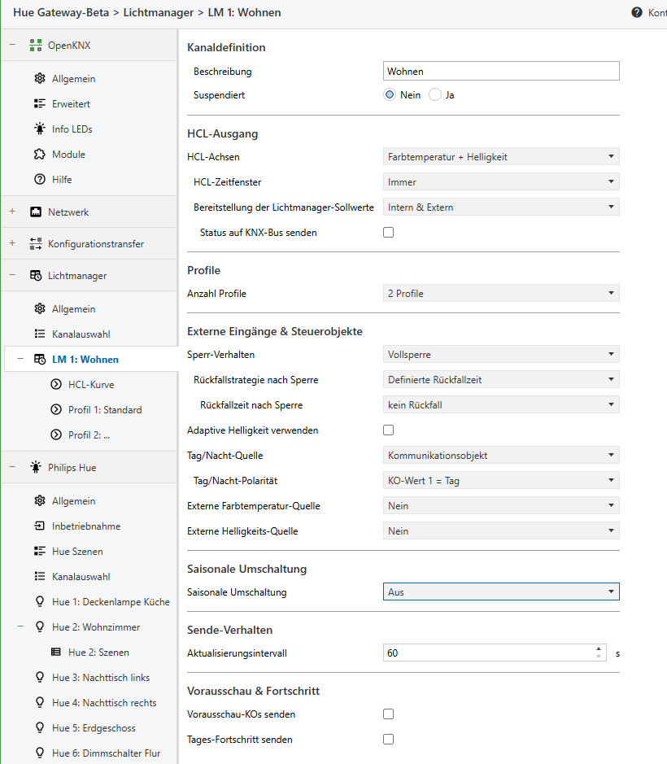
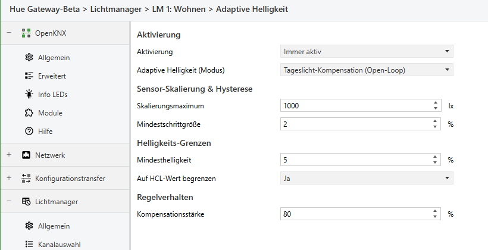
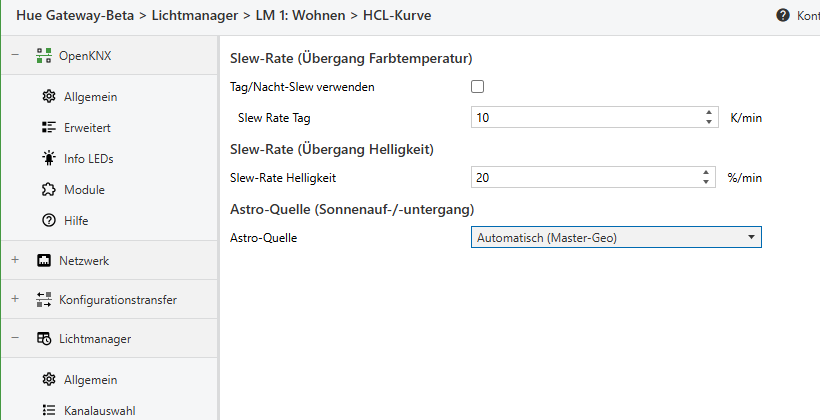
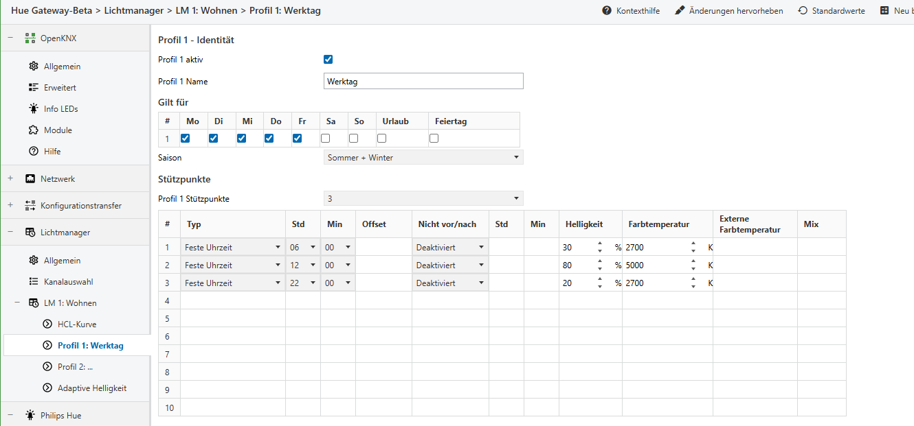
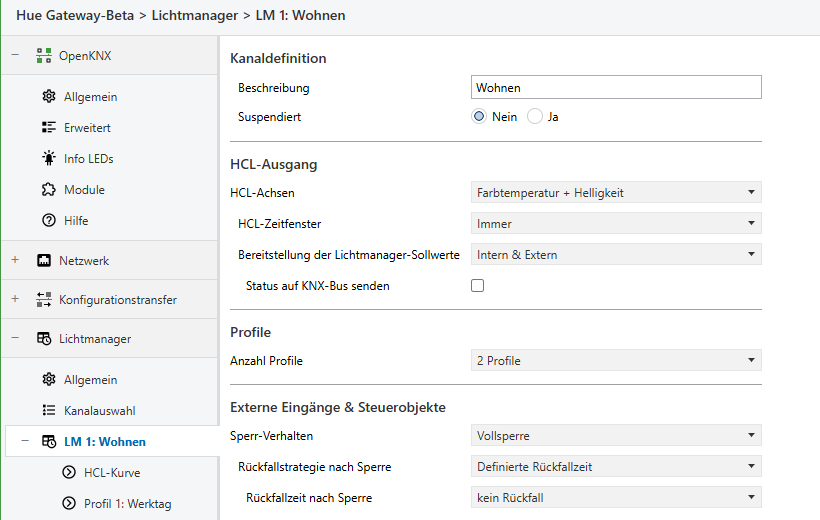

# Applikationsbeschreibung OFM-LightManager

OpenKNX Function-Module zur tageszeitabhängigen Steuerung von Helligkeit und Farbtemperatur (Human Centric Lighting).
Bis zu N unabhängige Lichtmanager (Anzahl per OAM vorgegeben) liefern Sollwerte, die von kompatiblen Ausgabemodulen (z. B. OFM-HueGatewayModule) konsumiert werden.

<!-- DOC HelpContext="Allgemein" -->
### Allgemein

(c) OpenKNX, Steffen Rittmeier 2026

Die vollständige Projektdokumentation ist unter https://github.com/OpenKNX/OFM-LightManager verfügbar.

Das Modul übernimmt die Berechnung der HCL-Sollwerte:

`Stützpunkte / Astro / Sensor` → `OFM-LightManager` → `Status-KOs / Konsumenten-Modul`

**Wichtig:**
- Das Modul stellt nur Sollwerte bereit. Die eigentliche Ausgabe an Leuchten erfolgt in den jeweiligen Ziel-Modulen oder GA´s.
- Parameter und KOs müssen in ETS konsistent projektiert werden.
- Logikfunktionen (Saison-Logik, Zentralfunktionen) können in dedizierten Logikmodulen umgesetzt werden.
<!-- DOCEND -->

## Inhaltsverzeichnis

- [Human Centric Lighting](#human-centric-lighting)
- [Kanalauswahl](#kanalauswahl)
- [Einstellungen](#einstellungen)
- [Sperre (global)](#sperre-global)
- [Rückfallstrategie nach Sperre](#rückfallstrategie-nach-sperre)
- [Status-KOs je Lichtmanager](#status-kos-je-lichtmanager)
- [Lichtmanager 1..N](#lichtmanager-1n)
- [Saison-Profil](#saison-profil)
- [Adaptive Helligkeit](#adaptive-helligkeit)
- [Kommunikationsobjekte](#kommunikationsobjekte)
- [HCL-Achsen (F1)](#hcl-achsen-f1)
- [HCL-Zeitfenster (F1)](#hcl-zeitfenster-f1)
- [HCL-Vorausschau (F3)](#hcl-vorausschau-f3)
- [HCL-Fortschritt (F4)](#hcl-fortschritt-f4)
- [HCL-Slewrate Tag/Nacht (F5)](#hcl-slewrate-tagnacht-f5-per-kanal)
- [HCL-Profile (F7)](#hcl-profile-f7)
- [HCL-Stützpunkte (F8)](#hcl-stützpunkte-f8)
- [Per-Kanal-Sperre (F2)](#per-kanal-sperre-f2)
- [Rückfallstrategie nach Per-Kanal-Sperre](#rückfallstrategie-nach-per-kanal-sperre)
- [Externe Eingänge (F12 + L6)](#externe-eingänge-f12--l6)
- [Migration auf 0.4.0](#migration-auf-040)
- [Migration auf 0.3.0](#migration-auf-030)
- [Häufige Fehler und Lösungen](#häufige-fehler-und-lösungen)

<!-- DOC -->
## Human Centric Lighting

Aktiviert zeitabhängige Sollwerte für Helligkeit und Farbtemperatur.
Bis zu N Lichtmanager (Anzahl per OAM vorgegeben) können parallel definiert werden.

<!-- DOC HelpContext="Lichtmanager" -->
### Lichtmanager

Bis zu N unabhängige Lichtmanager (Anzahl per OAM vorgegeben) berechnen Helligkeits- und Farbtemperatur-Sollwerte über den Tagesverlauf.
Jeder Lichtmanager besitzt eine eigene Kurvenkonfiguration, optionale Saison-Profile und optionale adaptive Helligkeitsregelung.
<!-- DOCEND -->

<!-- DOC -->
### Kanalauswahl

Bei aktiviertem Lichtmanager erscheint unter „Allgemein" der Tab **Kanalauswahl**. Er enthält je Lichtmanager eine Zeile mit den Spalten **Kanal**, **Kanalaktivität** und **Beschreibung**.
Nur aktivierte Lichtmanager erscheinen als eigener Tab „LM x" im Baum und werden in der Firmware ausgeführt. Die Beschreibung kann auch bei deaktivierten Lichtmanagern eingetragen werden.

<!-- DOC Skip="1" -->
Die Screenshots in dieser Beschreibung zeigen eine Beispielkonfiguration in der Applikation des Hue Gateways.

<!-- DOC Skip="1" -->
<kbd></kbd>

<!-- DOC HelpContext="Kanalaktivitaet" -->
#### Kanalaktivität

Schaltet den Lichtmanager ein (**Aktiviert**) oder aus (**Deaktiviert**).
Ein deaktivierter Lichtmanager wird im Baum ausgeblendet, liefert keine Sollwerte und kann in Konsumenten-Modulen (z. B. OFM-HueGatewayModule) nicht zugeordnet werden. Seine Einstellungen bleiben erhalten.
Zum vorübergehenden Abschalten ohne Ausblenden dient **Suspendiert** im Kanalkopf.
<!-- DOCEND -->

<!-- DOC -->
### Einstellungen

Ab Version 0.2 sind **Aktualisierungsintervall** und Überblendzeit pro Kanal konfigurierbar (siehe Abschnitt [Status-KOs je Lichtmanager](#status-kos-je-lichtmanager)). Die früheren globalen Parameter bleiben aus Speichergründen im Projekt bestehen, werden aber nicht mehr ausgewertet.

Sollwerte werden aus der Lichtmanager-Kurve berechnet und bei Wertänderung als Status-KO übertragen.

<!-- DOC -->
### Sperre (global)

Sperrt die automatische Ausgabe aller Lichtmanager.

<!-- DOC Skip="1" -->
<kbd></kbd>

### Sperr-Hierarchie

Die Sperren werden mit folgender Priorität ausgewertet:

```text
Kanal-Sperre
	> Manager-Sperre
		> Globale Sperre
```

Eine aktive Kanal-Sperre übersteuert also immer die managerbezogene und die globale Sperre. Das ist gewollt, damit einzelne Kanäle nach einer Szene oder einem Sonderbetrieb gezielt aus der HCL-Führung herausgenommen werden können, ohne andere Kanäle desselben Lichtmanagers zu beeinflussen.

<!-- DOC HelpContext="HCL-Sperre-global" -->
Sperrt die automatische Ausgabe aller Lichtmanager (HCL-Bereich).

Optionen:
- **Rückfallzeit nach Sperre** (inkl. Tageswechsel, `kein Rückfall` möglich)
- **Rückfallstrategie nach Sperre**: wirkt für globale, manager-spezifische und kanal-spezifische Sperren

KOs:
- `Sperre (global)` (Eingang)
- `Status Sperre` (Ausgang)
<!-- DOCEND -->

<!-- DOC HelpContext="HCL-Sperre-global-Status-HCL-Sperre" -->
Globale HCL-Sperre inkl. Statusrückmeldung.

- KO `Sperre (global)` (Eingang): Setzt die globale HCL-Sperre für alle Lichtmanager.
- KO `Status Sperre` (Ausgang): Gibt den aktuellen HCL-Sperrstatus zurück.
<!-- DOCEND -->

<!-- DOC -->
### Rückfallstrategie nach Sperre

Zusätzlich zur Rückfallzeit gibt es eine zentrale Strategie, wie Sperren wieder aufgehoben werden.
Diese Vorgabe gilt für globale, manager-spezifische und kanal-spezifische Sperren.

Verfügbare Strategien:
1. **Definierte Rückfallzeit**: verwendet ausschließlich die gewählte Rückfallzeit aus der Dropdown-Liste.
2. **Freie Dauer**: verwendet den Parameter **Freie Rückfalldauer** in Sekunden.
3. **Freie Uhrzeit**: verwendet den Parameter **Rückfall-Uhrzeit**.
4. **Dauer oder Uhrzeit**: hebt die Sperre auf, sobald entweder die freie Dauer abgelaufen ist oder die Rückfall-Uhrzeit erreicht wird.
5. **Nur externes Entsperren**: es erfolgt keine automatische Freigabe; die Sperre muss über ein KO aufgehoben werden.

Ergänzende Parameter:
- **Freie Rückfalldauer**: Bereich `0..65535 s`, Standard `1800 s`
- **Rückfall-Uhrzeit**: Standard `03:00`

Hinweis:
- Für das externe Entsperren steht zusätzlich das globale KO `Entsperren Trigger` zur Verfügung.

<!-- DOC -->
### Status-KOs je Lichtmanager

Jeder Kanal kann seine berechneten Sollwerte intern an angeschlossene Module (z. B. Hue-Gateway) und/oder als KNX-Status-KOs ausgeben. Datentyp und Timing werden pro Kanal konfiguriert.

<!-- DOC Skip="1" -->
<kbd></kbd>

<!-- DOC HelpContext="HCL-Kanal-Ausgabe-Verwendung" -->
#### Ausgabe verwenden

Legt fest, wohin der Lichtmanager-Kanal seine berechneten Sollwerte sendet:

- **Intern** – Der Kanal wird ausschließlich von internen Verbrauchern gelesen (z. B. Hue-Gateway-Modul). Es werden keine Status-KOs auf den KNX-Bus gesendet.
- **Extern** – Der Kanal sendet Sollwerte über die Status-KOs auf den KNX-Bus. Interne Verbraucher werden **nicht** beliefert.
- **Beides** – Der Kanal beliefert interne Verbraucher *und* sendet zusätzlich die Status-KOs auf den KNX-Bus.

Bei `Intern` bleiben die zugehörigen Status-KOs deaktiviert und belegen keine Gruppenadresse.
<!-- DOCEND -->

<!-- DOC HelpContext="HCL-Kanal-Ausgabe-Erweitert" -->
#### Status-KOs zusätzlich aktivieren

Nur sichtbar bei Verwendung `Intern`.

Wird diese Option gesetzt, werden die Status-KOs zusätzlich auf den KNX-Bus gesendet, obwohl der Kanal eigentlich nur intern arbeitet. Damit lassen sich Helligkeit, Farbtemperatur oder der kombinierte DPT 249.600-Wert zur Visualisierung oder Protokollierung mitlesen, ohne die interne Ausgabe zu unterbrechen.
<!-- DOCEND -->

<!-- DOC HelpContext="HCL-Kanal-Ausgabe-Datentyp" -->
#### Datentyp der Status-Ausgabe

Bestimmt, welche KNX-Status-KOs der Kanal verwendet:

- **Helligkeit + Farbtemperatur** – Zwei separate KOs:
  - `Status Helligkeit Soll` (`DPT 5.001`, 1 Byte, 0..100 %)
  - `Status Farbtemperatur Soll` (`DPT 7.600`, 2 Byte, K)
- **Kombiniert (DPT 249.600)** – Ein einzelnes 6-Byte-KO `Status Tunable White kombiniert` mit Helligkeit, Farbtemperatur und Überblendzeit in einem Telegramm.
- **Beides** – Sowohl die separaten KOs *als auch* das kombinierte DPT 249.600-KO werden gesendet.

Hinweis: Die separaten KOs nutzen die in den Aktoren konfigurierte Überblendzeit; das kombinierte KO 249.600 enthält die Überblendzeit als Telegrammbestandteil.
<!-- DOCEND -->

<!-- DOC HelpContext="HCL-Kanal-Aktualisierungsintervall" -->
#### Aktualisierungsintervall

Zeitlicher Abstand, in dem der Kanal seine berechneten Sollwerte erneut auswertet und – bei Wertänderung oder Ablauf des Intervalls – sendet.

- Bereich: **60 .. 3600 s** (1 Minute bis 1 Stunde)
- Standard: **60 s**

Empfehlung: 60–300 s ist für Wohnbereiche meist ausreichend. Sehr kurze Intervalle (< 60 s) sind nicht zulässig, um Busbelastung und Aktor-Logging zu schonen.

Hinweis: Wertänderungen, die durch HCL-Kurvenpunkte oder externe Eingriffe entstehen, werden auch zwischen den Zyklen sofort gesendet, wenn sie sich vom zuletzt gesendeten Wert unterscheiden.
<!-- DOCEND -->

<!-- DOC HelpContext="HCL-Kanal-Ueberblendzeit" -->
#### Überblendzeit

Zeit, in der ein Aktor von seinem aktuellen Wert auf den neuen HCL-Sollwert überblenden soll.

- Bereich: **1 .. 60 s**
- Standard: **6 s**

Verwendung je nach Datentyp:

- **Helligkeit + Farbtemperatur** – Die Überblendzeit wird *nicht* mitgesendet; verwendet wird die im Aktor projektierte Überblendzeit. Der Wert dient hier nur internen Verbrauchern (z. B. Hue-Gateway).
- **Kombiniert (DPT 249.600)** – Die Überblendzeit ist Teil des 6-Byte-Telegramms und wird vom Aktor unmittelbar verwendet.
- **Beides** – wirkt wie oben kombiniert.

Empfehlung: Werte zwischen 2 und 10 s vermeiden sichtbares „Springen“ und sind für Wohnräume angenehm.
<!-- DOCEND -->

<!-- DOC HelpContext="HCL-Kanal-StatusBrightness" -->
#### KO Status-Soll-Helligkeit

`DPT 5.001`, 1 Byte, 0…00 %.

Aktiv wenn **Ausgabe verwenden** = `Extern` oder `Beides`, und **Datentyp** = `Helligkeit + Farbtemperatur` oder `Beides`.

Der Kanal sendet den berechneten Helligkeits-Sollwert zyklisch gemäß **Aktualisierungsintervall** sowie sofort bei geändertem Wert.

Hinweis: Die Überblendzeit ist in diesem KO nicht enthalten — für weiche Übergänge im Aktor die **Slew-Rate** des Lichtmanagers verwenden oder das kombinierte DPT 249.600-KO nutzen.
<!-- DOCEND -->

<!-- DOC HelpContext="HCL-Kanal-StatusColorTemp" -->
#### KO Status-Soll-Farbtemperatur

`DPT 7.600`, 2 Byte, Kelvin (typisch 2000–6500 K).

Aktiv wenn **Ausgabe verwenden** = `Extern` oder `Beides`, und **Datentyp** = `Helligkeit + Farbtemperatur` oder `Beides`.

Der Kanal sendet den berechneten Farbtemperatur-Sollwert zyklisch gemäß **Aktualisierungsintervall** sowie sofort bei geändertem Wert.

Hinweis: Beide KOs (Helligkeit + Farbtemperatur) werden stets gemeinsam gesendet, auch wenn sich nur ein Wert geändert hat.
<!-- DOCEND -->

<!-- DOC HelpContext="HCL-Kanal-StatusCombined" -->
#### KO Status-Soll Kombi (DPT 249.600)

`DPT 249.600` (`DPST-249-600`), 6 Byte, Tunable White kombiniert.

Aktiv wenn **Ausgabe verwenden** = `Extern` oder `Beides`, und **Datentyp** = `Kombiniert (DPT 249.600)` oder `Beides`.

**Telegrammaufbau (Big-Endian, 6 Byte)**:

| Byte | Inhalt | DPT | Wert |
|---|---|---|---|
| 0–1 | Übergangszeit | DPT 7.004 (100-ms-Einheiten) | `Überblendzeit × 10` |
| 2–3 | Farbtemperatur | DPT 7.600 (Kelvin) | berechneter HCL-Sollwert |
| 4 | Helligkeit | DPT 5.001 skaliert (0–255) | `Helligkeit% × 255 / 100` |
| 5 | Maskierung | B8 | `0x07` (alle drei Validity-Bits gesetzt) |

Die Maskierung `0x07` bedeutet: Validity-Bit für Übergangszeit (b2), Farbtemperatur (b1) und Helligkeit (b0) sind alle gesetzt — der Empfänger soll alle drei Felder auswerten.

**Empfehlung MDT AKD LED Controller**: Objekt 77 (`Tunable White combined`) mit diesem KO verbinden, **Datentyp** = `Kombiniert` oder `Beides` wählen, **Überblendzeit** ≈ **Aktualisierungsintervall** oder kleiner für fließende Übergänge ohne sichtbare Stufen.
<!-- DOCEND -->

<!-- DOC -->
### Lichtmanager 1..N

<!-- DOC HelpContext="HCL-Manager-18" -->
Jeder Lichtmanager 1..N besitzt identischen Aufbau. Die Kanalseite „LM x" ist in folgende Abschnitte gegliedert:

- **Kanaldefinition**: Beschreibung und Suspendiert.
- **HCL-Ausgang**: HCL-Achsen, HCL-Zeitfenster, Bereitstellung der Lichtmanager-Sollwerte und Status-KOs (siehe [Status-KOs je Lichtmanager](#status-kos-je-lichtmanager)).
- **Profile**: Anzahl Profile (1–4). Jedes Profil hat eine eigene Unterseite mit Wochentagen, Saison und bis zu 10 Stützpunkten.
- **Externe Eingänge & Steuerobjekte**: Sperr-Verhalten mit Rückfallstrategie, adaptive Helligkeit, Tag/Nacht-Quelle sowie externe Farbtemperatur- und Helligkeitsquelle.
- **Saisonale Umschaltung**: Wechsel zwischen Sommer- und Winter-Profilen (siehe [Saison-Profil](#saison-profil)).
- **Sende-Verhalten**: Aktualisierungsintervall.
- **Vorausschau & Fortschritt**: optionale KOs zum nächsten Stützpunkt und zum Tagesverlauf.

Im Baum liegen unter jedem Lichtmanager die Unterseiten **HCL-Kurve**, **Profil 1..n** und, wenn aktiviert, **Adaptive Helligkeit**.
<!-- DOCEND -->

<!-- DOC Skip="1" -->
<kbd></kbd>

Jeder Manager besitzt identischen Aufbau:

#### Beschreibung
Freie ETS-Bezeichnung des Lichtmanagers. Sie erscheint im Baum („LM x: Beschreibung"), in der Kanalauswahl und in den KO-Texten.

#### Suspendiert
Der Lichtmanager bleibt projektiert und sichtbar, wird aber von der Firmware nicht ausgeführt (keine Sollwerte, keine KOs). Im Baum wird er als suspendiert markiert.

#### Sperr-Verhalten
Legt fest, ob und wie der Lichtmanager gesperrt werden kann:
- **Nein**: keine Sperre.
- **Vollsperre**: Das KO `LM x: Eingang, Sperre=1` sperrt Helligkeit und Farbtemperatur gemeinsam.
- **Getrennt (Helligkeit / Farbtemperatur)**: Zwei KOs sperren Helligkeit bzw. Farbtemperatur einzeln.

Während einer Sperre erhalten die zugeordneten Konsumenten-Kanäle keine automatischen Sollwerte. Wann die Sperre wieder aufgehoben wird, legen **Rückfallstrategie nach Sperre** und **Rückfallzeit nach Sperre** fest, siehe [Per-Kanal-Sperre (F2)](#per-kanal-sperre-f2) und [Rückfallstrategie nach Per-Kanal-Sperre](#rückfallstrategie-nach-per-kanal-sperre).

#### HCL-Kurve
Unterseite mit den Übergangs- und Astro-Parametern:
- **Tag/Nacht-Slew verwenden**: getrennte Slew-Rate für Tag und Nacht, siehe [HCL-Slewrate Tag/Nacht (F5)](#hcl-slewrate-tagnacht-f5-per-kanal).
- **Slew Rate Tag** bzw. **Nacht** (K/min, `0` = keine Begrenzung): begrenzt die Änderung der Farbtemperatur pro Minute.
- **Slew-Rate Helligkeit** (%/min): begrenzt die Änderung der Helligkeit pro Minute.
- **Astro-Quelle**: `Automatisch (Master-Geo)` berechnet Sonnenauf- und -untergang aus Standort und Zeitzone der OpenKNX-Basisparameter; `Manuell (Per-Kanal Sunrise/Sunset)` verwendet die Zeiten **Sonnenaufgang** und **Sonnenuntergang** dieses Lichtmanagers.

#### Stützpunkte
Die Stützpunkte werden je Profil auf dessen Unterseite gepflegt, bis zu 10 je Profil. Ihre Anzahl legt **Profil x Stützpunkte** fest. Die Tabelle hat folgende Spalten:

| Spalte | Bedeutung |
|---|---|
| **Typ** | `Feste Uhrzeit`, `Sonnenaufgang`, `Sonnenuntergang`, `Bürgerl. Dämmerung Anfang`, `Bürgerl. Dämmerung Ende` oder `Solarer Mittag` |
| **Std / Min** | Uhrzeit, nur bei Typ `Feste Uhrzeit` |
| **Offset** | Verschiebung gegenüber dem Astro-Ereignis in Minuten, nur bei den Astro-Typen |
| **Nicht vor/nach** | `Deaktiviert`, `Nicht vor` oder `Nicht nach`: begrenzt den Stützpunkt auf die dahinter eingetragene Uhrzeit (Std / Min) |
| **Helligkeit** | Helligkeit in % |
| **Farbtemperatur** | Farbtemperatur in K |
| **Externe Farbtemperatur** / **Mix** | Nur bei eingestellter externer Farbtemperatur-Quelle: `Aus`, `Immer (übersteuern)`, `Nur wenn extern größer` oder `Nur wenn extern kleiner`, dazu der Mischanteil in % |

Hinweise:
- Nicht alle 10 Stützpunkte müssen belegt werden.
- Zwischen den Stützpunkten wird linear interpoliert. Der letzte Stützpunkt eines Tages gilt bis zum ersten Stützpunkt des nächsten Tages.
- Astro-Stützpunkte wandern mit dem Jahresverlauf. Mit **Nicht vor/nach** lässt sich verhindern, dass z. B. „Sonnenaufgang" im Sommer zu früh liegt.

Beispiel (Vorbelegung von Profil 1):
- SP1 `Feste Uhrzeit 06:00 / 30 % / 2700 K`
- SP2 `Feste Uhrzeit 12:00 / 80 % / 5000 K`
- SP3 `Feste Uhrzeit 22:00 / 20 % / 2700 K`

Praxisregel:
- `Aktualisierungsintervall`, `Überblendzeit` und `Slew-Rate` gemeinsam abstimmen, damit Übergänge ruhig bleiben.
- Throttle-Semantik (Variante A): Während des Aktualisierungsintervalls werden keine Zwischenwerte gesendet. Nach Ablauf des Intervalls wird der **dann aktuelle** Sollwert gesendet, auch wenn er sich zwischenzeitlich wieder dem zuletzt gesendeten Wert angeglichen hat.
- Bei **Status-KO-Ausgabe** `Nur Kombi (6B DPT-249-600)` übernimmt der Aktor die Überblendzeit direkt aus dem Telegramm — Slew-Rate und Einzel-KOs werden in diesem Fall nicht benötigt.
- Empfehlung: `Überblendzeit ≤ Aktualisierungsintervall`, sonst läuft ein noch aktiver Überblendvorgang in den nächsten Sollwert hinein.
- Empfehlung MDT AKD: **Status-KO-Ausgabe** `Alle (1B + 2B + 6B parallel)`, `Überblendzeit = 6–30 s`, `Slew-Rate = 0` (der Aktor übernimmt die Glättung).

### Saison-Profil

Mit der saisonalen Umschaltung kann ein Lichtmanager im Sommer andere Profile verwenden als im Winter, z. B. „Werktag Sommer" und „Werktag Winter" mit unterschiedlichen Stützpunkten.

**Hintergrund**: Im Sommer steht die Sonne bei Sonnenuntergang (z. B. 19:00 Uhr) noch hoch, der Himmel ist hell und das Auge nimmt warmes Licht als „zu gelb" wahr. Im Winter hingegen ist die Dämmerung um dieselbe Uhrzeit längst abgeschlossen — warmes Licht fühlt sich natürlicher an. Mit der saisonalen Umschaltung lassen sich beide Situationen parametrieren, ohne zwei separate Lichtmanager anlegen zu müssen.

Zwei Einstellungen wirken zusammen:
1. **Saisonale Umschaltung** auf der Kanalseite des Lichtmanagers legt fest, woher die Information „Sommer" oder „Winter" kommt (siehe unten).
2. **Saison** auf jeder Profil-Unterseite legt fest, wann das Profil gilt: `Sommer + Winter`, `Sommer`, `Winter` oder `Fallback`. Der Parameter erscheint nur, wenn die saisonale Umschaltung nicht auf `Aus` steht.

#### Saisonale Umschaltung

| Einstellung | Beschreibung |
|---|---|
| **Aus** | Keine Saison-Auswertung. Profile mit der Saison `Sommer` oder `Winter` werden nicht gewählt. |
| **Automatisch (Astro + Offset)** | Sommer und Winter werden automatisch bestimmt. **Saison-Offset** (−90…+90 Tage) verschiebt den Wechsel. |
| **Festes Datum** | Sommer gilt von **Sommer-Beginn** (Monat, Tag) bis **Sommer-Ende** (Monat, Tag). Ein Zeitraum über den Jahreswechsel ist möglich (Südhalbkugel). |
| **Kommunikationsobjekt** | Das KO `LM x: Eingang, Sommer=1` schaltet zwischen Sommer und Winter um. |

Beispiel „Festes Datum": Sommer-Beginn `1. April`, Sommer-Ende `30. September`.

Ob der zuletzt empfangene Zustand des KOs gespeichert wird und womit nach einem Neustart vorbelegt wird, steht unter **Lichtmanager → Allgemein**, Abschnitt „Saisonale Umschaltung (global)".

#### KO: LM x: Eingang, Sommer=1

<!-- DOC HelpContext="HCL-Saison-KO" -->
Kommunikationsobjekt **LM x: Eingang, Sommer=1** (Eingang, 1 Bit, DPT 1.001).

Nur sichtbar, wenn die **Saisonale Umschaltung** des Lichtmanagers auf **Kommunikationsobjekt** steht.

- Wert `1` = Sommer
- Wert `0` = Winter

Steht unter **Lichtmanager → Allgemein** die Einstellung „Saisonalen Zustand speichern und beim nächsten Neustart als Vorbelegung nutzen?" auf **Ja**, wird der zuletzt empfangene Wert gespeichert und nach einem Neustart wiederhergestellt. Sonst gilt die dort eingestellte Vorbelegung (`Nichts (undefiniert)`, `Wert vom Bus lesen`, `Winter (0)` oder `Sommer (1)`).

Bei den anderen Einstellungen (Aus, Automatisch, Festes Datum) wechselt der Lichtmanager selbst; dieses KO ist dann nicht sichtbar.
<!-- DOCEND -->

### Adaptive Helligkeit

<!-- DOC HelpContext="HCL-Adaptive-Helligkeit" -->
Passt die Soll-Helligkeit automatisch an das Umgebungslicht an. Voraussetzung ist ein Helligkeitssensor, der seinen Messwert per KO sendet.

Verfügbare Modi:
- **Aus**: Keine adaptive Regelung — Lichtmanager arbeitet nur nach HCL-Kurve.
- **Tageslicht-Kompensation (Open-Loop)**: Misst das aktuelle Umgebungslicht und zieht es vom HCL-Sollwert ab. Je heller es draußen ist, desto weniger Kunstlicht wird eingeschaltet. Einfach und stabil, empfohlen für die meisten Räume.
- **Konstantlichtregelung (Closed-Loop)**: Vergleicht den Sensorwert fortlaufend mit dem HCL-Sollwert und korrigiert die Leuchten laufend nach bis beide übereinstimmen. Geeignet wenn eine sehr genaue Beleuchtungsstärke erforderlich ist (z. B. Arbeitsplatz nach DIN EN 12464).
<!-- DOCEND -->

<!-- DOC Skip="1" -->
<kbd></kbd>

#### Adaptive Helligkeit (Modus)

<!-- DOC HelpContext="HCL-Adaptive-Modus" -->
Wählt den Betriebsmodus der adaptiven Helligkeitsregelung:

- **Deaktiviert**: Keine adaptive Regelung — Lichtmanager arbeitet nur nach HCL-Kurve.
- **Tageslicht-Kompensation (Open-Loop)**: Der Sensor misst das aktuelle Umgebungslicht (Lux). Dieses wird vom HCL-Sollwert abgezogen: viel Tageslicht → Kunstlicht wird reduziert, wenig Tageslicht → Kunstlicht bleibt hoch. Es gibt keine Rückkopplung — der berechnete Wert wird direkt ausgegeben, ohne zu prüfen ob das Ergebnis wirklich stimmt. Das macht den Modus einfach, stabil und für die meisten Räume ausreichend.
- **Konstantlichtregelung (Closed-Loop)**: Der Regler vergleicht den aktuellen Sensorwert laufend mit dem HCL-Sollwert und passt die Leuchten so lange nach, bis beide übereinstimmen. Im Gegensatz zu Open-Loop wird also nicht einmalig berechnet sondern fortlaufend korrigiert. Das ergibt eine präzisere Regelung, erfordert aber sorgfältige Parametrierung (Kp, Totband) damit der Regler nicht schwingt. Empfohlen für Bereiche mit genauer Beleuchtungsanforderung.
<!-- DOCEND -->


#### Aktivierung

<!-- DOC HelpContext="HCL-Adaptive-Aktivierung" -->
Steuert, wann die adaptive Regelung aktiv ist:

- **Immer aktiv**: Regelung läuft unabhängig von Tageszeit.
- **Nur tagsüber (per KO)**: Regelung ist nur aktiv, wenn das KO „Tag/Nacht" den Tageswert meldet. Polarität konfigurierbar mit „Tag/Nacht-Polarität".
- **Nach Uhrzeit**: Regelung ist nur innerhalb des konfigurierten Zeitfensters aktiv (Startzeit / Endzeit).
<!-- DOCEND -->

#### Tag/Nacht-Polarität

<!-- DOC HelpContext="HCL-Adaptive-Polaritaet" -->
Legt fest, welcher KO-Wert „Tag" bedeutet. Nur sichtbar bei Aktivierung = „Nur tagsüber (per KO)".

- **1 = Tag, 0 = Nacht** (Standard): KO-Wert `1` aktiviert die Regelung.
- **0 = Tag, 1 = Nacht**: KO-Wert `0` aktiviert die Regelung.

Passend zur Polarität des sendenden Gerätes einstellen (z. B. Präsenzmelder, Zeitschaltuhr, Logikbaustein).
<!-- DOCEND -->

#### Startzeit / Endzeit

<!-- DOC HelpContext="HCL-Adaptive-Zeitfenster" -->
Definiert das Zeitfenster, in dem die adaptive Regelung aktiv ist. Nur sichtbar bei Aktivierung = „Nach Uhrzeit".

- **Startzeit**: Beginn der aktiven Phase.
- **Endzeit**: Ende der aktiven Phase.

Außerhalb des Zeitfensters ist die adaptive Regelung pausiert; der Lichtmanager folgt nur der HCL-Kurve.
<!-- DOCEND -->

#### Skalierungsmaximum

<!-- DOC HelpContext="HCL-Adaptive-Skalierungsmaximum" -->
Gibt den maximalen Lux-Wert des Sensors an, bei dem die Regelung vollständig ausgesteuert ist. Dieser Parameter muss auf den tatsächlichen Messbereich des verwendeten Sensors abgestimmt werden — er ist kein Raumtyp-Richtwert, sondern ein Sensor-Kennwert.

**Wie der Wert verwendet wird:**

- *Open-Loop*: Bei Sensorwert ≥ Skalierungsmaximum wird die Helligkeit maximal reduziert (auf Mindesthelligkeit). Dazwischen wird linear skaliert.
- *Closed-Loop*: Das Skalierungsmaximum rechnet den HCL-Sollwert (%) in einen Lux-Zielwert um: `Ziel-Lux = HCL-Sollwert% × Skalierungsmaximum`. Der Regler arbeitet auf diesen Zielwert hin.

**Beispiel mit einem Innensensor (max. 1000 Lux):**

Skalierungsmaximum = 1000 Lux, HCL-Sollwert = 80 %, Sensorwert = 500 Lux, Stärke = 80 %:
- Open-Loop: `80% × (1 − 500/1000 × 0,8) = 80% × 0,6 = 48%`
- Closed-Loop: Ziel = 800 Lux, Ist = 500 Lux → Regler erhöht die Helligkeit

**Beispiel mit einem Außensensor (max. 50.000 Lux):**

Wird ein Außensensor verwendet, muss das Skalierungsmaximum entsprechend hoch eingestellt werden.
Skalierungsmaximum = 1000 Lux, Sensorwert = 50.000 Lux → Sensorwert weit über Maximum → Helligkeit fällt sofort auf Mindesthelligkeit, völlig unabhängig vom HCL-Profil. Das ist in diesem Fall falsch.
Korrekt wäre Skalierungsmaximum = 50.000 Lux, damit der Sensor seinen vollen Bereich nutzt.

**Orientierungswerte je Sensortyp:**

- Einfacher Innensensor (bis 1.000 Lux): 500–1.000 Lux
- Hochwertiger Innensensor (bis 10.000 Lux): 1.000–5.000 Lux
- Außensensor / Dachsensor (bis 100.000 Lux): 20.000–65.000 Lux
<!-- DOCEND -->

#### Kompensationsstärke

<!-- DOC HelpContext="HCL-Adaptive-Staerke" -->
*(Nur bei Tageslicht-Kompensation, Open-Loop)*

Prozentualer Anteil, mit dem die Helligkeitsreduktion auf den HCL-Sollwert angewendet wird.

- **100 %**: Volle Kompensation — bei Skalierungsmaximum wird auf die Mindesthelligkeit abgesenkt.
- **50 %**: Halbe Kompensation — sanfterer Eingriff ins HCL-Profil.

Bei 0 % ist die Regelung wirkungslos; in dem Fall stattdessen Modus „Aus" verwenden.
<!-- DOCEND -->

#### Auf HCL-Wert begrenzen

<!-- DOC HelpContext="HCL-Adaptive-CeilToHCL" -->
*(Nur bei Konstantlichtregelung, Closed-Loop)*

- **Ja**: Die geregelte Helligkeit überschreitet nie den aktuellen HCL-Sollwert. Tageslicht „ersetzt" das Kunstlicht, die Leuchte wird nie heller als der HCL-Sollwert.
- **Nein**: Regelung kann auch über den HCL-Sollwert hinausgehen (z. B. für reine Lux-Regelung ohne HCL-Bezug).

Empfehlung: **Ja**, um ungewolltes Aufhellen bei schlechten Lichtverhältnissen zu verhindern.
<!-- DOCEND -->

#### P-Faktor (Kp)

<!-- DOC HelpContext="HCL-Adaptive-Kp" -->
*(Nur bei Konstantlichtregelung, Closed-Loop)*

Proportionalverstärkung des Reglers. Höhere Werte reagieren schneller, können aber bei trägen Sensoren instabil werden:

- **0.5**: Langsame, sehr stabile Regelung
- **1.0**: Standardwert, ausgewogen
- **1.5**: Schnellere Reaktion
- **2.0**: Aggressiv, nur bei stabilen Sensoren empfohlen

Empfehlung: Mit `1.0` beginnen und bei Bedarf anpassen.
<!-- DOCEND -->

#### Totband

<!-- DOC HelpContext="HCL-Adaptive-Totband" -->
*(Nur bei Konstantlichtregelung, Closed-Loop)*

Minimale Abweichung in Lux zwischen Soll- und Istwert, ab der der Regler eingreift. Verhindert ständiges Nachregeln bei kleinen Schwankungen des Sensors.

Empfehlung: 30–80 Lux je nach Sensorgenauigkeit. Bei sehr empfindlichen Sensoren eher höher wählen.
<!-- DOCEND -->

#### Mindesthelligkeit

<!-- DOC HelpContext="HCL-Adaptive-Mindesthelligkeit" -->
Untergrenze der Helligkeitsreduktion durch die adaptive Regelung. Die Helligkeit wird nie unter diesen Wert gesenkt, auch wenn das Umgebungslicht das Skalierungsmaximum überschreitet.

Verhindert, dass der Raum bei sehr hellem Tageslicht vollständig dunkel geregelt wird.
<!-- DOCEND -->

#### Sensor-Timeout (0=aus)

<!-- DOC HelpContext="HCL-Adaptive-Timeout" -->
Maximale Zeit in Minuten ohne neuen Lux-Messwert, bevor der Sensor als ausgefallen gilt und die adaptive Regelung pausiert wird. Nach Ablauf folgt der Lichtmanager wieder nur der HCL-Kurve.

- `0` = kein Timeout (nicht empfohlen — bei Sensorausfall bleibt die letzte Reduktion dauerhaft aktiv).
- Empfehlung: 5–15 Minuten, abhängig vom Sendeintervall des Sensors.
<!-- DOCEND -->

#### Mindestschrittgröße

<!-- DOC HelpContext="HCL-Adaptive-Mindestschritt" -->
Minimale Helligkeitsänderung in Prozent, die der Regler tatsächlich ausführen muss. Berechnete Korrekturen unterhalb dieses Schwellwerts werden ignoriert.

Verhindert Flackern bei sehr kleinen, rauschbedingten Korrekturen. Empfehlung: 1–3 %.
<!-- DOCEND -->

#### Kommunikationsobjekte der adaptiven Regelung

<!-- DOC HelpContext="HCL-Adaptive-KOs" -->
Kommunikationsobjekte für die adaptive Helligkeit je Lichtmanager:

- **Helligkeitssensor (Lux)** (Eingang, DPT 9.004): Umgebungslichtstärke vom Sensor
- **Tag/Nacht** (Eingang, DPT 1.001): Aktivierungssignal (Polarität konfigurierbar)
- **Adaptive Helligkeit aktiv** (Ausgang, DPT 1.011): Status: Regelung aktuell aktiv

Das KO „Tag/Nacht" ist nur sichtbar, wenn Aktivierung = „Nur tagsüber (per KO)".
Das KO „Adaptive Helligkeit aktiv" meldet, ob die Regelung gerade eingreift (z. B. für Logiken oder Visualisierung).
<!-- DOCEND -->

<!-- DOC -->
## Kommunikationsobjekte

### Globale Kommunikationsobjekte

#### Sperre (global) / Status Sperre
Globale Sperre inkl. Statusrückmeldung.

#### Entsperren Trigger
1-Bit Triggerobjekt zum gleichzeitigen Aufheben aller globalen, manager-spezifischen und kanal-spezifischen Sperren.

#### Sperre Lichtmanager 1..N / Status
Lichtmanager-spezifische Sperrobjekte inkl. Statusrückmeldung.
Sichtbar nur für Lichtmanager, die in der **Kanalauswahl** aktiviert sind.

#### Lichtmanager Status Helligkeit Soll / Farbtemperatur Soll
Je Lichtmanager zwei Sollwert-KOs; Sichtbarkeit abhängig von Option **Status-KOs je Lichtmanager**.

### Pro-Lichtmanager Kommunikationsobjekte

#### LM x: Eingang, Sommer=1 (K04)
1-Bit Eingang (DPT 1.001). Nur sichtbar bei **Saisonale Umschaltung** = `Kommunikationsobjekt`. Der Zustand wird gespeichert, wenn unter Lichtmanager → Allgemein „Saisonalen Zustand speichern…" auf **Ja** steht.

#### Helligkeitssensor (Lux)
2-Byte Eingang (DPT 9.004). Eingang für die adaptive Helligkeitsregelung.

#### Tag/Nacht (K06)
1-Bit Eingang (DPT 1.001). Nur sichtbar bei `DayNightSource = KO` (Adaptive Helligkeit oder Slew Tag/Nacht).

#### Adaptive Helligkeit aktiv
1-Bit Ausgang (DPT 1.011). Status der adaptiven Regelung.

### Pro-Kanal Kommunikationsobjekte (0.3.0)

| KO | Nr. | DPT | Funktion | Bedingung |
|---|---|---|---|---|
| Sperre | K02 | DPST-1-3 | Vollsperre Ein/Aus | `UseLock ≠ Nein` |
| Status Sperre | K03 | DPST-1-11 | Status der Kanalsperre | `UseLock ≠ Nein` |
| Status Tunable White kombiniert | K08 | DPST-249-600 | Helligkeit + CT + Überblendzeit | `StatusKoOutput` inkl. Kombiniert |
| LockColor | K09 | DPST-1-3 | Farbtemperatur-Achse sperren | `UseLock = Getrennt` |
| LockBrightness | K10 | DPST-1-3 | Helligkeits-Achse sperren | `UseLock = Getrennt` |
| Minuten bis nächstem SP | K11 | DPT 7.006 | Vorausschau: Minuten | `PreviewEnable = Ja` |
| Nächste Farbtemperatur | K12 | DPT 7.600 | Vorausschau: CT des nächsten SP | `PreviewEnable = Ja` |
| Nächste Helligkeit | K13 | DPT 5.001 | Vorausschau: Helligkeit des nächsten SP | `PreviewEnable = Ja` |
| Tagesfortschritt | K14 | DPT 5.001 | 0–100 % des Tagesverlaufs | `ProgressEnable = Ja` |
| Tagesphase | K15 | DPT 5.010 | 0=vor Aufgang … 5=Nacht | `ProgressEnable = Ja` |
| Externe Helligkeit (%) | K16 | DPT 5.001 | Externe Helligkeitsquelle | `ExtBrightnessDpt = Prozent` |
| Externe Helligkeit (lx) | K17 | DPT 9.004 | Externe Helligkeit, Lux-skaliert | `ExtBrightnessDpt = Lux` |
| Externe Farbtemperatur (K) | K18 | DPT 7.600 | Externe CT-Quelle | `ExtColorTempDpt = Kelvin` |
| Externe Farbtemperatur (Skalar) | K19 | DPT 5.001 | Externe CT, skaliert | `ExtColorTempDpt = Skalar` |

<!-- DOC HelpContext="HCL-Achsen" -->
## HCL-Achsen (F1)

Per-Kanal-Parameter **HCL-Achsen** (`CHHclAxes`) bestimmt, welche Ausgangsgrößen der Kanal produziert:

- **Aus**: HCL ist deaktiviert. K00/K01/K08/K11/K12/K13/K14/K15 senden nicht, `onLightManagerPartial()` wird nicht aufgerufen, `IntegrationMode`/`BusStatusEnable`/`StatusKoOutput` sind in ETS ausgeblendet.
- **Helligkeit + Farbtemperatur** (Default): beide Achsen aktiv.
- **Nur Farbtemperatur**: K00 (Brightness) und K13 (NextBrightness) verstummen; `validMask` an Senken auf Bit 0 reduziert.
- **Nur Helligkeit**: K01 (ColorTemp) und K12 (NextColorTemp) verstummen; `validMask` an Senken auf Bit 1 reduziert.

Die Filterung greift in `_shouldSendAxis()` **vor** dem KO-Send und vor dem partial-Sink-Aufruf. K11/K14/K15 sind achsen-neutral und gelten als „aktiv" sobald mindestens eine Achse aktiv ist.
<!-- DOCEND -->

<!-- DOC HelpContext="HCL-Zeitfenster" -->
## HCL-Zeitfenster (F1)

Per-Kanal-Parameter **HCL-Zeitfenster** (`CHHclTimeWindow`):

- **Immer** (Default): kein Zeit-Gate.
- **Nur tagsüber**: K00/K01/K08/K11–K15 senden nur zwischen Sonnenaufgang und Sonnenuntergang.
- **Nur nachts**: nur außerhalb dieses Bereichs.

Achsen- und Zeit-Filter sind **UND**-verknüpft. Tag/Nacht-Quelle ist `DayNightSource`; bei `Aus` greift intern eine Astronomie-Berechnung als Fallback, damit das Zeit-Gate auch ohne projektiertes K06 funktioniert.
<!-- DOCEND -->

<!-- DOC HelpContext="HCL-Vorausschau" -->
## HCL-Vorausschau (F3)

Per-Kanal aktivierbar über `PreviewEnable`. Wenn aktiviert, sendet der Kanal:

- **K11 Minuten bis nächstem Stützpunkt** (DPT 7.006)
- **K12 Nächste Farbtemperatur** (DPT 7.600)
- **K13 Nächste Helligkeit** (DPT 5.001)

`LookAheadMinutes` legt fest, wie weit voraus gescannt wird. Δ-Schwellen verhindern Bus-Spam: ΔK ≥ 50 K, ΔBrightness ≥ 1 %, ΔMinutes ≥ 1.

Bei leerem Profil (kein aktiver SP) wird kein Send ausgeführt.
<!-- DOCEND -->

<!-- DOC HelpContext="HCL-Fortschritt" -->
## HCL-Fortschritt (F4)

Per-Kanal aktivierbar über `ProgressEnable`. Sendet:

- **K14 Tagesfortschritt** (DPT 5.001, 0…100 %): lineare Position zwischen erstem und letztem aktiven Stützpunkt des Tages.
- **K15 Tagesphase** (DPT 5.010): 0 = vor Sonnenaufgang, 1 = Vormittag, 2 = Mittag (±1 h um Solar-Noon), 3 = Nachmittag, 4 = Abend, 5 = Nacht.

Quelle für die Phasen-Berechnung ist die interne Sonnenstands-Engine.
<!-- DOCEND -->

<!-- DOC HelpContext="HCL-Slewrate-TagNacht" -->
## HCL-Slewrate Tag/Nacht (F5, Per-Kanal)

`UseDayNightSlew=Nein` → `_slewRate` 24/7 konstant.

`UseDayNightSlew=Ja`:

| DayNightSource | Verhalten |
|---|---|
| **KO** | `SlewRateNight` wenn K06=0, sonst `SlewRateDay` |
| **AstroIntern** | `SlewRateNight` wenn Sonne unter Horizont, sonst `SlewRateDay` |
| **Aus** | Fallback auf `SlewRateDay` (kein Wechsel) |

Per-Kanal — kein Master-Aggregat. Jeder Kanal entscheidet eigenständig.

<!-- DOC Skip="1" -->
<kbd></kbd>
<!-- DOCEND -->

<!-- DOC HelpContext="HCL-Profile" -->
## HCL-Profile (F7)

Pro Master stehen bis zu **4 Profil-Slots** mit je **10 Stützpunkten** (SetpointV2) zur Verfügung. `ProfileCount` (1–4) limitiert sichtbare Slots.

Jedes Profil besitzt eine **Wochentag-/Sonderbedingungs-Maske** (16 Bit, davon 12 genutzt):

| Bit | Bedeutung |
|---|---|
| 0–6 | Mo, Di, Mi, Do, Fr, Sa, So |
| 7 | Urlaub (`KoLOG_Vacation`) |
| 8 | Feiertag (OFM-LogicModule) |
| 9 | **Default-Fallback** (exklusiv: bei gesetztem Bit 9 werden alle anderen Bits ignoriert) |
| 10 | Sommer |
| 11 | Winter |

**Selektor-Spezifität**: Profile mit konkreter Wochentag-/Saison-Übereinstimmung gewinnen gegen Default-Fallback. Bei mehreren passenden Profilen gewinnt das Profil mit der höchsten Spezifität (Anzahl gesetzter, matchender Bits).

<!-- DOC Skip="1" -->
<kbd></kbd>
<!-- DOCEND -->

<!-- DOC HelpContext="HCL-Stuetzpunkte" -->
## HCL-Stützpunkte (F8)

Jeder Stützpunkt (SetpointV2) trägt:

- **AnchorType**: `FixedTime`, `Sunrise±`, `Sunset±`, `CivilDawn±`, `CivilDusk±`, `SolarNoon±`
- **AnchorOffsetMin** (–720…+720 min)
- **ClampMode**: Frei / Nicht vor / Nicht nach / Festklemmen
- Kelvin (1500–10000) und Brightness (0–100 %)
- Per-SP **ExtColorTempMode** (Off / Always / OnlyGreater / OnlySmaller) und **ExtMixPercent**

Anker werden in `tickAstro()` aus dem aktuellen Sonnenstand aufgelöst; ein DST-Cache vermeidet Re-Resolves außerhalb von Datums-/DST-Wechseln.
<!-- DOCEND -->

<!-- DOC HelpContext="HCL-Saison-Quelle" -->
## Saison-Quelle (F7-Hybrid)

Parameter **Saisonale Umschaltung** (`SeasonSource`) je Lichtmanager:

- **Aus**: Profile mit der Saison `Sommer` oder `Winter` werden nicht gewählt (saison-neutral).
- **Automatisch (Astro + Offset)**: automatische Bestimmung; **Saison-Offset** (`SeasonOffsetDays`, −90…+90 Tage) verschiebt den Wechsel.
- **Festes Datum**: **Sommer-Beginn** / **Sommer-Ende** als (Monat, Tag); unterstützt Jahreswechsel-Übergang (Südhalbkugel).
- **Kommunikationsobjekt**: K04 `LM x: Eingang, Sommer=1` (DPT 1.001) schaltet zur Laufzeit.

**Vorbelegung** (`SummerActiveInit`, unter Lichtmanager → Allgemein): `Nichts (undefiniert)` / `Wert vom Bus lesen` / `Winter (0)` / `Sommer (1)`.

**Persistenz** (`SummerActiveSavePower=Ja`): letzter K04-Wert in `OpenKNX::Flash` (Per-Master Slot `{magic:0x03, summerActive:bool}`); überschreibt Init beim Reboot. Bei `Nein` wird der Slot mit `0x00`-Bytes überschrieben. Magic 0x03 ⇒ Layout-Mismatch (z. B. alter 0x02-Block) wird erkannt und ignoriert.

<!-- DOC Skip="1" -->
<kbd></kbd>
<!-- DOCEND -->

<!-- DOC HelpContext="HCL-Sperre-Kanal" -->
## Per-Kanal-Sperre (F2)

Parameter **CHUseLock** (3-Wege):

- **Nein**: K02/K03/K09/K10 in ETS unsichtbar, Handler ignorieren Telegramme, Rückfall-Block weg.
- **Vollsperre**: nur K02 (Eingang) + K03 (Status) sichtbar; sperrt beide Achsen.
- **Getrennt**: zusätzlich **K09 LockColor** und **K10 LockBrightness** (DPT 1.003 disable/enable) sichtbar. Einseitige Sperre friert nur die betroffene Achse ein. K08-Validity-Bit reflektiert achsenspezifisch.

**Hierarchie**: K02 = 1 dominiert über K09/K10. Globale Sperre (Modul-K02/K03/K04) dominiert über **alle** Per-Kanal-Locks, auch bei `UseLock=Nein`. Lock-Auswertung liegt **vor** `_shouldSendAxis()`.
<!-- DOCEND -->

<!-- DOC HelpContext="HCL-Sperre-Rueckfall-Kanal" -->
## Rückfallstrategie nach Per-Kanal-Sperre

Per-Kanal `FallbackPolicy` (6 Werte):

| Wert | Verhalten |
|---|---|
| **Definierte Rückfallzeit** | `LockFallback` (Minuten) — Auto-Release nach Ablauf |
| **Freie Dauer** | `FallbackDurationSec` (Sekunden) frei konfigurierbar |
| **Freie Uhrzeit** | `FallbackReleaseTime` (HH:MM) — Release am nächsten Erreichen |
| **Dauer oder Uhrzeit** | Was zuerst eintritt |
| **Nur externes Entsperren** | Kein Auto-Release, bleibt bis K02=0 |
| **Deaktiviert** | Bleibt bis Reboot |

Gilt einheitlich für alle aktiven Per-Kanal-Locks (Vollsperre und Getrennt). Bei Getrennt-Modus + K09=1 + K02=1 gleichzeitig werden beim Auto-Release beide gemeinsam freigegeben.

Globaler und Per-Kanal-Fallback laufen **unabhängig** auf ihren jeweiligen Lock-Quellen.
<!-- DOCEND -->

<!-- DOC HelpContext="HCL-Externe-Eingaenge" -->
## Externe Eingänge (F12 + L6)

Per-Kanal überschreib- oder fallback-bare Werte aus externen Quellen:

**Farbtemperatur** (`ExtColorTempSource` = Aus / Override / Fallback):
- `ExtColorTempDpt = 2B Kelvin` → **K18 ExtColorTempKelvin** (DPT 7.600), Bereich 1500…10000 K.
- `ExtColorTempDpt = 1B Skalar` → **K19 ExtColorTempScalar** (DPT 5.001, 0…255), mit Skalierung `k = ExtKelvinMin + scalar * (ExtKelvinMax − ExtKelvinMin) / 255` (Defaults 2700 / 6500 K).

**Helligkeit** (`ExtBrightnessSource` = Aus / Override / Fallback):
- `ExtBrightnessDpt = 1B Prozent` → **K16 ExtBrightnessPercent** (DPT 5.001, 0…100 %).
- `ExtBrightnessDpt = 2B Lux` → **K17 ExtBrightnessLux** (DPT 9.004), mit Skalierung `pct = lux * 100 / ExtLuxMax` (Default 500 lx).

**Fallback-Timeout** (`ExtFallbackTimeoutSec`): bei Fallback-Modus springt der Kanal nach Ablauf ohne neues Telegramm zurück auf den internen HCL-Wert.

Per-SP **ExtColorTempMode** + **ExtMixPercent** erlauben gezieltes Mischen (z. B. „abends nur einbeziehen wenn externer Wert kleiner ist"). Mix-Formel: `(interp * (100 − mix) + extK * mix) / 100`.
<!-- DOCEND -->

## Migration auf 0.4.0

> **Breaking — Kanalauswahl.** Der Parameter „Verfügbare Kanäle" entfällt. Nach dem ETS-Update sind **alle Lichtmanager deaktiviert** und müssen im Tab **Kanalauswahl** wieder aktiviert werden. Die Einstellungen der einzelnen Lichtmanager bleiben erhalten.

- Konsumenten-Module (z. B. OFM-HueGatewayModule ab 0.8.0) prüfen die Zuordnung zur Laufzeit: Ein zugeordneter, aber deaktivierter oder suspendierter Lichtmanager wird ignoriert und im Log gemeldet.
- API: `getMasterCount()` liefert die höchste mögliche Master-Nummer; ob ein Lichtmanager existiert, zeigt `channel(n) != nullptr` bzw. `getMaster(n) != nullptr`.

<!-- DOC HelpContext="Migration-0.3.0" -->
## Migration auf 0.3.0

> **Breaking — keine Auto-Migration aus 0.2.x.** ETS-Projekte aus 0.2.x sind nicht migrationsfähig; alle HCL-Konfigurationen müssen je Lichtmanager neu projektiert werden.

**Wesentliche Änderungen**:
- HCL-Datenmodell auf **ProfileV2** umgestellt: 4 Profile × 10 Stützpunkte je Master, mit Wochentag-/Saison-/Default-Maske.
- **62 Legacy-Stützpunkt-Parameter** entfernt; `CurveType`-Parameter komplett gestrichen.
- **`KoBlockSize` wächst von 12 auf 22**: nachgelagerte Module (insb. OFM-HueGatewayModule) müssen ihre `KoOffset`/`KoSingleOffset` neu berechnen. Alle Gruppenadressen nachgelagerter Module müssen neu verknüpft werden.
- `SeasonMode` → `SeasonSource` umbenannt; Werte abgebildet wie folgt:
  - 0.2 `Standard` → 0.3 `Aus`
  - 0.2 `Automatisch (DST)` → 0.3 `Automatisch (DST)`
  - 0.2 `Festes Datum` → 0.3 `Festes Datum`
  - 0.2 `Per KO` → 0.3 `Per KO`
- **NVS-Magic 0x02 → 0x03**: alte Per-Master-Summer-Slots werden beim Boot ignoriert; `SummerActiveInit` greift, neuer Block mit Magic 0x03 wird geschrieben.
- Variante-E-Dispatch ersetzt 0.2.0 `StatusKoEnable`/`StatusKoDpt`: neue Parameter `IntegrationMode`, `BusStatusEnable`, `StatusKoOutput` mit feiner KO-Granularität.

**Out-of-Box**: nach ETS-Download liefert HCL sofort Werte (Default-SPs in Profil 1: morgens 2700 K / 30 %, mittags 5000 K / 80 %, abends 2700 K / 20 %).
<!-- DOCEND -->

<!-- DOC -->
## Häufige Fehler und Lösungen

### Lichtmanager-Parameter oder HCL-KOs fehlen
- Lichtmanager global aktiviert?
- Lichtmanager in der **Kanalauswahl** aktiviert?
- Erst nach Aktivierung des globalen Lichtmanagers werden Zuordnung und Sperrparameter sichtbar.

### Lichtmanager wirkt nicht
- Lichtmanager global aktiviert?
- Manager im Konsumenten-Modul zugewiesen?
- Manager in der **Kanalauswahl** aktiviert und nicht **Suspendiert**?
- Gilt heute ein Profil? Mindestens ein Profil muss aktiv sein und unter **Gilt für** den aktuellen Wochentag (bzw. Urlaub/Feiertag) enthalten.
- Hat das Profil Stützpunkte mit sinnvollen Uhrzeiten bzw. Astro-Typen?
- Bei Astro-Stützpunkten: Standort und Zeitzone in den OpenKNX-Basisparametern gesetzt bzw. bei **Astro-Quelle** `Manuell` Sonnenauf- und -untergang eingetragen?
- Globale/spezifische Sperre aktiv?

### Saison-Profil schaltet nicht um
- **Saisonale Umschaltung** steht auf `Aus`? → Dann werden Profile mit der Saison `Sommer` oder `Winter` nicht gewählt.
- Ist bei den Profilen die **Saison** passend gesetzt (`Sommer`, `Winter`, `Sommer + Winter` oder `Fallback`)?
- Bei `Festes Datum`: Sommer-Beginn und Sommer-Ende korrekt eingetragen? Liegt das Datum im Bereich?
- Bei `Automatisch (Astro + Offset)`: Systemzeit und Datum korrekt?
- Bei `Kommunikationsobjekt`: KO `LM x: Eingang, Sommer=1` mit einer GA verbunden und Wert `1` gesendet?

<!-- DOC -->
## Lizenz und Haftung

Open-Source-Modul im OpenKNX-Umfeld.
Keine Gewährleistung; Nutzung in eigener Verantwortung.
